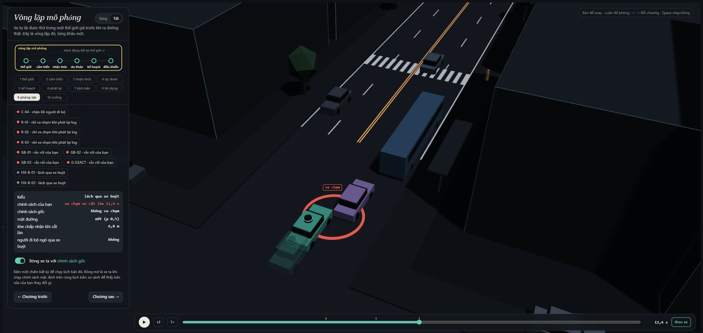
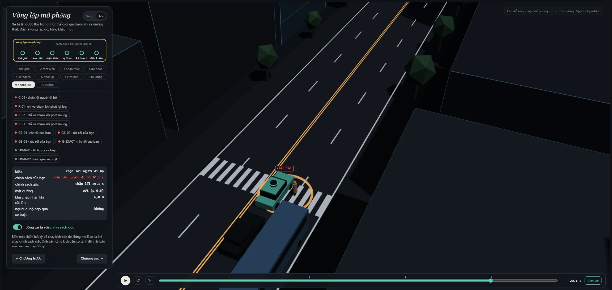
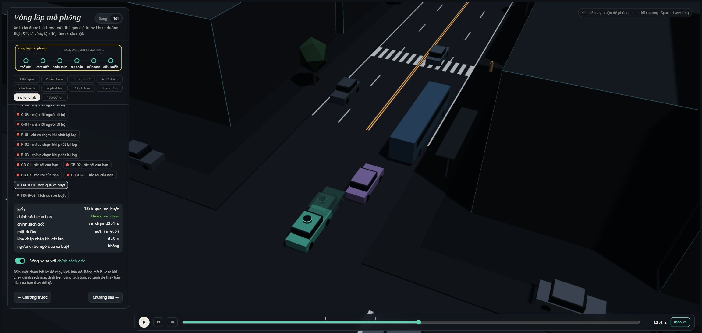
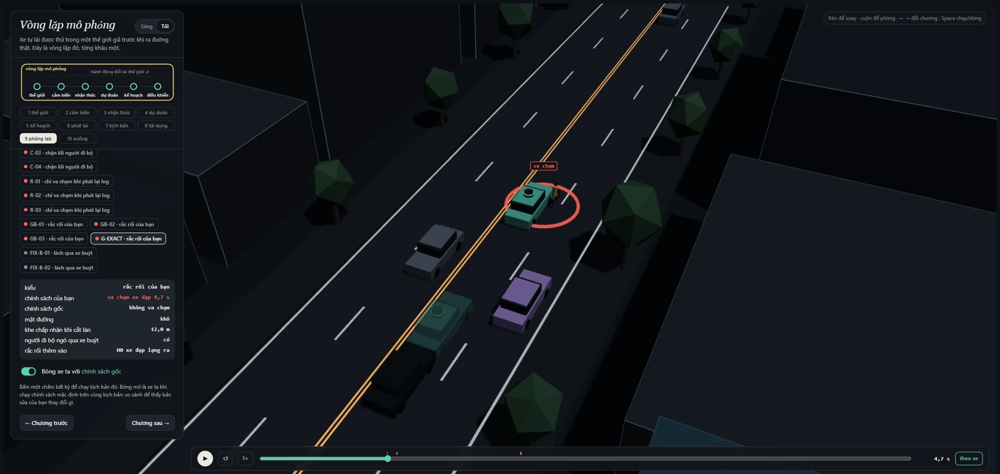

MSSV: 2A202602590

# Lab 11 · Scenario Forge — Phạm Văn Kiên

Thị trấn: **B** (`meta.json: _run.town`). Toàn bộ evidence dùng ngân sách đầy đủ (`quick=false`), không đổi lõi mô phỏng, phân phối, seed hoặc các policy ứng viên gốc.

MSSV có chữ A: chạy bằng `python run_lab.py all`, hoặc đặt `LAB11_MSSV=2A202602590` rồi chạy `run_all.py all`. Giữ nguyên chuỗi MSSV khi hash. Seed trong `meta.json: seeds`: {"mc": 481571095, "search": 2867798003, "test": 3403477366}. Các bảng dưới đọc trực tiếp từ JSON bằng `write_report.py`.

## 1. Phát lại log có trung thực không?

`replay.json`: n=400; bỏ 1 log có người lái thất bại; còn 399 kịch bản. Replay có 131 va chạm (115 rear, 16 side, 0 front); reactive có 0; crash_in_both=0.

Xe sau trong log tiếp tục quỹ đạo đã ghi, không biết planner mới phanh sớm hơn người lái. Nó đâm vào ego trong đánh giá phản thực, dù nếu thực sự có mặt nó có thể phanh theo IDM. Vì vậy các va chạm replay-only không phải bằng chứng planner chắc chắn gây tai nạn trong thế giới phản ứng.

Ví dụ `replay.json: replay_only[0]`, scenario=0, contact=rear, TTC nhỏ nhất trong reactive=2.70765 s. TG chạy theo log người lái và tông đuôi ego đã giảm tốc. Reactive phản ứng lại nên tránh được. Có thể xem bằng nút R-01 trong viewer.

## 2. Kịch bản bất khả thi

`lab11/feasible.py: is_feasible` loại nếu: (1) gia tốc ngang `(π/cutDur)²×3.5/2 > μg`; (2) phanh sau nhập làn `cutBrake > μg`; (3) người đi bộ `pedV > 2.5 m/s`; (4) `cutV` ngoài `(0,22] m/s`. Thời gian đổi làn không dương cũng bị loại. Hai luật đầu dựa trên giới hạn bám đường, hai luật sau giới hạn nhóm tác nhân và vận tốc mà bài lab cho phép.

| Cuộc săn (`hunt.json`) | Kịch bản bất khả thi | Thất bại tìm được theo nhãn |
|---|---:|---|
| bus_bypass | 6 | {"bus_bypass": 76} |
| cut_in | 4 | {"bus_bypass": 21, "crosswalk_block": 1} |
| crosswalk_block | 13 | {"bus_bypass": 3, "crosswalk_block": 36} |
| rear_ended | 8 | {"crosswalk_block": 32, "bus_bypass": 1} |

Cuộc săn crosswalk_block loại nhiều nhất: 13. Các biến làm giảm khoảng phanh hoặc thời gian đổi làn có thể tăng điểm nguy hiểm, kéo CEM về rìa khả thi. Không suy ra luật nào chiếm đa số chỉ từ tổng này. Pipeline bỏ mẫu bất khả thi trước mô phỏng và trước cập nhật elite; nếu đếm chúng là thất bại thì sẽ thổi phồng rủi ro bằng các chuyển động không xảy ra được. `mc.json: infeasible`=18.

## 3. Monte Carlo cho biết gì?

`mc.json`: k=1, n=3000, p̂=0.000333333; Wilson 95%=[5.88424e-05, 0.00188587]. Chỉ gặp bus_bypass. Để sai số khoảng ±20% của p, gần đúng n≈1.96²(1−p)/(0.2²p)=288,024 (quy tắc 96/p≈288,000). Đây là dự toán dùng p̂ rất bất định từ đúng một lần thất bại.

cut_in, crosswalk_block, rear_ended và other chưa xuất hiện. Với mỗi kiểu, báo cận Wilson trên 0.0012789 (`mc.json: per_mode.<mode>.hi`), không kết luận xác suất bằng 0. Chặn lối P1 cũng được tính là thất bại dù chưa có tiếp xúc hình học.

## 4. Importance sampling, ESS và suy biến

`estimate.json: seeds[s].per[m]` (600 mẫu/kiểu/seed). Ô không hit báo cận `upper_zero_hits`; giá trị p thô trong JSON bằng 0 chỉ là kết quả đếm, không được diễn giải là xác suất thực bằng 0.

| Seed | Kiểu | p̂ hoặc cận trên khi chưa thấy | hits | ESS | top_share |
|---:|---|---:|---:|---:|---:|
| 0 | bus_bypass | 0.00158616 | 37 | 117.94 | 0.8423 |
| 0 | cut_in | ≤ 0.025 | 0 | 115.03 | 0.0000 |
| 0 | crosswalk_block | 7.24953e-07 | 61 | 118.32 | 0.2297 |
| 0 | rear_ended | ≤ 0.025 | 0 | 116.67 | 0.0000 |
| 1 | bus_bypass | 0.000173947 | 22 | 116.97 | 0.5300 |
| 1 | cut_in | ≤ 0.025 | 0 | 124.65 | 0.0000 |
| 1 | crosswalk_block | 9.28609e-07 | 65 | 128.63 | 0.2950 |
| 1 | rear_ended | ≤ 0.025 | 0 | 101.03 | 0.0000 |
| 2 | bus_bypass | 0.00158782 | 28 | 120.44 | 0.8454 |
| 2 | cut_in | ≤ 0.025 | 0 | 120.18 | 0.0000 |
| 2 | crosswalk_block | 8.78259e-06 | 55 | 119.99 | 0.9074 |
| 2 | rear_ended | ≤ 0.025 | 0 | 121.11 | 0.0000 |

Tổng điểm ước lượng của ba seed (`estimate.json: seeds[].total`): 0.00158688, 0.000174876, 0.00159661; chênh lớn nhất/nhỏ nhất=9.13 lần. Bus_bypass ở seed 0 và 2 cao hơn MC nhưng vẫn trong khoảng Wilson rất rộng của MC; seed 1 thấp hơn nhiều. Không đủ căn cứ kết luận ba seed đã hội tụ.

top_share >0.5 ở bus_bypass cả ba seed và crosswalk_block seed 2: hơn nửa kết quả đến từ đúng một mẫu. ESS đo sự lệch trọng số toàn bộ mẫu, không chứng minh đã phủ đủ mọi vùng thất bại; top_share nhỏ cũng không chứng minh hội tụ. Crosswalk_block chênh hơn một bậc giữa seed 0 và 2 dù có nhiều hit, vì các hit có trọng số rất khác nhau.

Ngân sách `estimate.json: budget`=16,800, gồm 4×8×300 mẫu săn và 4×3×600 mẫu IS, chưa cộng 3,000 MC để lấy other. Theo các p̂ bus_bypass, MC muốn ±20% cần khoảng 60,524, 551,892, 60,460 mẫu. Tuy nhiên IS ở đây chưa đạt ±20%: khoảng ±1.96se/p̂ của bus_bypass lần lượt 1.66, 1.09, 1.66; không thể gọi tỷ lệ ngân sách này là mức tăng tốc ở cùng độ chính xác.

`estimate.json: other` lấy từ MC: k=0, n=3000, hi=0.0012789. Nhãn other là tập dư không có điểm săn riêng, nên dùng MC để không bỏ sót nó. Với 0 hit trong IS: q≥0.2p ⇒ cận 95% xấp xỉ 3/(0.2×600)=0.025, không dùng 3/ESS. `seeds[].hi` là khoảng xấp xỉ do pipeline xuất; các kiểu không hit vẫn cần báo cận riêng, không dùng riêng tổng này để chứng nhận an toàn.

## 5. Các kiểu thất bại và ảnh 3D

**Bus bypass:** C2 chờ khe rồi lách xe buýt đỗ; khi C2 xâm lấn làn ở tốc độ thấp, ngưỡng ngang của ego nhận nó là xe dẫn quá muộn. Ego va vào C2 trước x=112 m với C2 dưới 6 m/s. Ảnh chụp tại sự kiện của B-01, tham số đầy đủ trong `viewer.json: runs` và thời điểm trong `review-scenes.json`.

**Crosswalk block:** xe buýt che P1. Người không ngó qua xe buýt chờ theo phần đường nhìn được rồi bước ra. Ego phanh nhưng thân xe dừng trên vạch x=122, chắn đường P1; P1 dừng lại chứ không bước xuyên thân xe. Đây là sự kiện kind=block, không đồng nhất với contact.

Không tìm được đúng nhãn cut_in và rear_ended trong các cuộc săn của chúng. Điều đó chỉ giới hạn kết quả ở 8 vòng×300 mẫu, không chứng minh chúng không thể xảy ra. `hunt.json: cut_in.found` và `rear_ended.found` còn chứa bus_bypass/crosswalk_block: một cuộc săn chung dễ lặp lại một cơ chế dễ tìm, nên cần tách điểm nguy hiểm theo kiểu và kiểm tra nhãn thực tế.

## 6. Sửa planner: TRAIN và TEST

Policy chọn từ TRAIN (`fix.json: chosen.policy`): `{"cutinLat": 3.0}`. Xếp theo fail_hi nhỏ nhất trong các ứng viên giữ ≥95% progress baseline; không xếp lại theo TEST.

| Nguồn trong fix.json | fail | fail_hi_seen | fail_hi | progress (m) | harsh (khung hình/lần chạy) | unseen |
|---|---:|---:|---:|---:|---:|---|
| baseline_train | 0.0125679 | 0.0357097 | 0.0357097 | 216.2779 | 9.0742 | — |
| chosen | 1.05831e-06 | 2.00609e-06 | 2.00609e-06 | 216.2651 | 8.7656 | bus_bypass |
| baseline_test | 0.00209876 | 0.00447088 | 0.00574978 | 213.6074 | 8.5647 | — |
| chosen_test | 2.14719e-05 | 6.25115e-05 | 0.0388414 | 213.4713 | 8.0697 | bus_bypass |

Trên TEST, thay đổi quãng đường=-0.064% so baseline; quãng đường được cắt tại sự kiện thất bại đầu tiên. `harsh` là số khung hình có a<−3 m/s² trung bình, không phải số đợt phanh độc lập. Baseline TRAIN có 216.2779 m, nên ngưỡng chọn là 205.4640 m.

TEST dùng seed mới, săn lại dưới policy đã chọn và 3.000 mẫu tự nhiên mới để bắt các kiểu khác. Một kiểu biến mất trong mẫu vẫn mang cận 3/(0.2×400)=0.0375 vào fail_hi. Vì vậy fail_hi có thể lớn hơn fail baseline dù nhiều tình huống cụ thể được cứu; không được thay fail_hi bằng fail_hi_seen để tuyên bố đạt chứng nhận. Các khoảng IS vẫn là xấp xỉ hữu hạn mẫu, đặc biệt khi top_share cao.

Ảnh FIX dùng cảnh B-01 hoặc cảnh thất bại đầu tiên được cứu; nút FIX-* trong `review.html` đặt xe chính là policy đã chọn, bóng mờ là baseline. Bóng mờ thể hiện quỹ đạo baseline va chạm còn xe chính tránh được. Các nút B-*/C-* gốc của exporter ghim baseline làm xe chính, nên không dùng nhãn readout của chúng để đảo kết luận về policy.

Ví dụ núm nghe an toàn nhưng có thể phản tác dụng: tăng T kéo giãn khoảng cách ego, tạo khe để C2 đổi làn; thế giới phản ứng nên rủi ro không đơn điệu. Tương tự hạ cautionV nhiều có thể giảm tiến độ và đổi thời điểm gặp P1/C2. Bảng TRAIN dưới đây là đo thực tế trên cùng tập mẫu; không dùng các số này để thay thế TEST.

| Policy ứng viên | TRAIN fail | TRAIN fail_hi | progress (m) |
|---|---:|---:|---:|
| `{"cautionV": 5.0}` | 5.21574e-05 | 0.00012703 | 171.873 |
| `{"cautionV": 6.5}` | 0.0026094 | 0.00615759 | 200.687 |
| `{"cautionV": 6.0}` | 0.000706738 | 0.00183029 | 188.804 |
| `{"cautionV": 9.0}` | 0.000297192 | 0.000655452 | 229.312 |
| `{"cautionV": 8.5}` | 0.000394644 | 0.000779146 | 225.642 |
| `{"cutinLat": 2.6}` | 0.0133093 | 0.0366191 | 216.271 |
| `{"cutinLat": 3.0}` | 1.05831e-06 | 2.00609e-06 | 216.265 |
| `{"cutinLat": 3.3}` | 1.05831e-06 | 2.00609e-06 | 216.259 |
| `{"T": 2.0}` | 0.0144208 | 0.037812 | 207.592 |
| `{"cutinLat": 3.0, "cautionV": 6.5}` | 5.43629e-06 | 1.4087e-05 | 200.652 |
| `{"cutinLat": 3.0, "cautionV": 7.0}` | 1.623e-06 | 2.94098e-06 | 210.196 |
| `{"cutinLat": 2.6, "cautionV": 7.0, "pedBuffer": 3.5}` | 1.623e-06 | 2.94098e-06 | 210.209 |

## 7. Từ mô phỏng ra đường thật

| Giả định | Dữ liệu cần và nguồn cụ thể | Hướng sai lệch nếu giả định quá lạc quan |
|---|---|---|
| Khe chấp nhận của C2, lognormal median 12 m ở B | Quỹ đạo camera trên cao tại đoạn có xe buýt đỗ, đo khe trước/sau lúc bắt đầu nhập làn; dùng INTERACTION/inD để đối chiếu hành vi nhưng cần thu riêng bối cảnh xe buýt | Nếu khe thực nhỏ hơn, nhiều lần nhập sát đầu ego hơn, ước lượng bus_bypass có thể bị thấp; tương tác thời điểm có thể làm quan hệ không đơn điệu |
| 85% người đi bộ ngó qua xe buýt | Video đồng bộ từ camera vỉa hè và xe, gán nhãn hướng đầu, phần đường nhìn được, thời điểm bước ra; bổ sung quan sát thực địa có xe buýt đỗ vì quỹ đạo đơn thuần không xác định được động tác ngó | Nếu ít người ngó hơn mô hình, tăng tình huống P1 bước ra khi ego bị che, có thể tăng crosswalk_block |
| 30% đường ướt; μ=0.5 ướt và 0.8 khô | Nhật ký mưa trên đúng tuyến kết hợp đo ma sát bằng xe đo hoặc thử phanh có kiểm soát theo loại lốp, mặt đường và tốc độ | Nếu μ thực thấp hơn hay đường ướt nhiều hơn, khoảng phanh thực dài hơn và rủi ro phanh muộn có thể bị đánh giá thấp |

Không lấy tần suất hiếm ở mô phỏng làm số liệu giao thông thực. Cần hiệu chỉnh phân phối chung và các tương quan (mưa, tầm nhìn, hành vi), không chỉ thay từng trung bình độc lập.

## 8. Giới hạn

1. Chỉ một đoạn phố và 24 s: xác suất theo một lần mô phỏng không đại diện mọi tuyến hoặc mọi độ dài chuyến đi.
2. Xe khác chủ yếu IDM, đổi làn bằng chấp nhận khe, hành vi người đi bộ được lập trình: không có toàn bộ độ trễ, mất chú ý hoặc kiểu lái ngoài đời.
3. Cảm biến trong lõi gần lý tưởng ngoài che khuất, không có đầy đủ sai số phát hiện/định vị và thời gian suy luận thực; sai lệch sim-to-real không được bao trong Wilson CI.

Nếu có thêm một tuần: thu video khe nhập làn và hành vi P1 quanh xe buýt; thêm trễ cảm biến/phanh; chia lại holdout theo cảnh và thời tiết; tăng ngân sách cho các kiểu không hit và kiểm tra độ phủ proposal qua nhiều seed trước khi báo mức rủi ro nhỏ.

## 9. Rắc rối riêng: xe đạp lạng vào làn trước giao lộ

Xe đạp H0 chạy ở mép trái E2, lạng 2 m vào E1 khi ego còn cách 9 m. Cảnh chính xác bắt đầu ở x=0, v=3 m/s, d=−1.2 m, swDur=1.9 s. Tương tự người đi xe đạp né chướng ngại trên mép đường rồi đi vào đường xe phía sau. Planner đợi đủ xâm lấn ngang mới nhận là vật cản dẫn đường, nên có nguy cơ phanh muộn. `mine.json: exact.planner`=[["ego", "H0", 4.65]].

`hazard.json: space`: x∼U[−5,10] m; v∼U[2,4] m/s; khoảng cách kích hoạt∼U[7,13] m; swDur∼U[1.9,2.2] s. Đây là dải thiết kế có chủ đích để thử xâm lấn ngang trước giao lộ x=80, không phải mẫu đã fit từ video. Gia tốc ngang π²×2/(2swDur²)=2.04–2.73 m/s², dưới 3; tốc độ tương đương 7.2–14.4 km/h. Mọi điều kiện khác lấy theo thị trấn B (`mine.json: conditional_on`).

Quét chính thức 1.500 mẫu: accepted=0.998667, infeasible=2 (`mine.json`).

| mine.json | n sau lọc chồng lấn | Tổng va chạm | avoidable | unavoidable | unattributed | low_speed | avoidable_foreknown |
|---|---:|---:|---:|---:|---:|---:|---:|
| baseline | 1498 | 1243 | 837 | 404 | 2 | 1 | 837 |
| chosen | 1498 | 0 | 0 | 0 | 0 | 0 | 0 |

| Policy | P(lỗi planner ∣ hazard) | Wilson 95% | Tần suất/chuyến với exposure giả định 0.002 | Cận trên/chuyến |
|---|---:|---|---:|---:|
| baseline | 0.558745 | [0.533481, 0.583708] | 0.00111749 | 0.00116742 |
| chosen | ≤ 0.00255793 (0/1498 hit) | [0, 0.00255793] | ≤ 5.11585e-06 | 5.11585e-06 |

Chỉ avoidable là tử số lỗi planner: phanh tối đa từ khung đầu hazard đã hoạt động và cảm biến nhìn thấy thì tránh được mọi va chạm ego. unavoidable vẫn va chạm khi phanh như vậy. unattributed là va chạm đầu tiên với tác nhân không quy cho hazard; không nhất thiết chỉ do hazard chưa bắt đầu. low_speed là cờ chồng lên các loại, khi ego<1 m/s, không phải loại thứ tư. Kiểm tra tổng ba loại bằng crashes.

Oracle phản ứng ngay khi nhìn thấy và phanh tối đa nên lạc quan hơn planner thực có độ trễ; theo hướng này avoidable có thể đếm nhiều hơn số tai nạn thực tế có thể cứu. Ngược lại, chỉ thử phanh, không thử đánh lái, có thể bỏ sót những vụ tránh được bằng điều khiển khác. Khoảng cách avoidable_foreknown−avoidable phản ánh phần thiệt hại vì che khuất trong phép thử này.

Exposure không có dữ liệu thực để hiệu chỉnh: giả định vận hành minh họa P(gặp xe đạp gần làn)=0.1/chuyến × P(lạng∣gặp)=0.02, bằng 0.002/chuyến (`hazard.json: why`). Hai số là giả định được công khai, không phải thống kê đã quan sát; không dùng để tuyên bố rủi ro ngoài đời. Bảng độ nhạy:

| Exposure giả định/chuyến | Baseline/chuyến | Policy chọn/chuyến |
|---:|---:|---:|
| 0.0002 | 0.000111749 | ≤ 5.11585e-07 |
| 0.002 | 0.00111749 | ≤ 5.11585e-06 |
| 0.02 | 0.0111749 | ≤ 5.11585e-05 |

Đặt cạnh bus_bypass: trung vị ba seed IS=0.00158616 trên một lần chạy tự nhiên 24 s. Tần suất xe đạp có exposure là 0.00111749 baseline và cận trên 5.11585e-06 policy chọn. Chỉ so được trong quy ước một chuyến tương ứng một đoạn 24 s và exposure đã nêu; mẫu số và độ bất định không đủ để xếp hạng rủi ro ngoài đời.

Bản sửa từ E dùng cutinLat=3.0, nhận tác nhân đang lấn ngang làm xe dẫn sớm hơn. Nó cũng xử lý tốt hazard xe đạp: 0 va chạm trên 1498 mẫu, so với 1243 baseline. Đây là kết quả khái quát tốt trên dải đã chọn, không phải một hazard còn đánh bại bản sửa. Không kết luận rủi ro bằng 0: cận Wilson vẫn là 0.00255793. Bước sau nên thử dự đoán vùng chiếm chỗ ngang của xe đạp trong 1–2 s, TTC theo hộp chuyển động và giới hạn gia tốc, đồng thời đánh giá TG để tránh dời lỗi sang tông đuôi; quyết định bằng TRAIN mới thay vì chọn lại trên TEST đang báo cáo.

Chưa thu bản ghi tự lái của người dùng; không khẳng định một người đã tránh được. Kết luận tránh được trong bài này đến từ oracle có quy tắc cụ thể, không phải thử lái thủ công.

## Kiểm tra và tái lập

31 kiểm thử TODO và 10 kiểm thử parity Python/JavaScript đạt. Xem `evidence/validation.txt` cho lệnh và kết quả. Evidence chính thức: world, replay, mc, hunt, cloud, estimate, fix, mine, viewer; `review.html`, `review-data.js`, `review-scenes.json` và ảnh là công cụ xem/bằng chứng bổ sung. Các probe thiết kế hazard không ghi đè các số chính thức.
